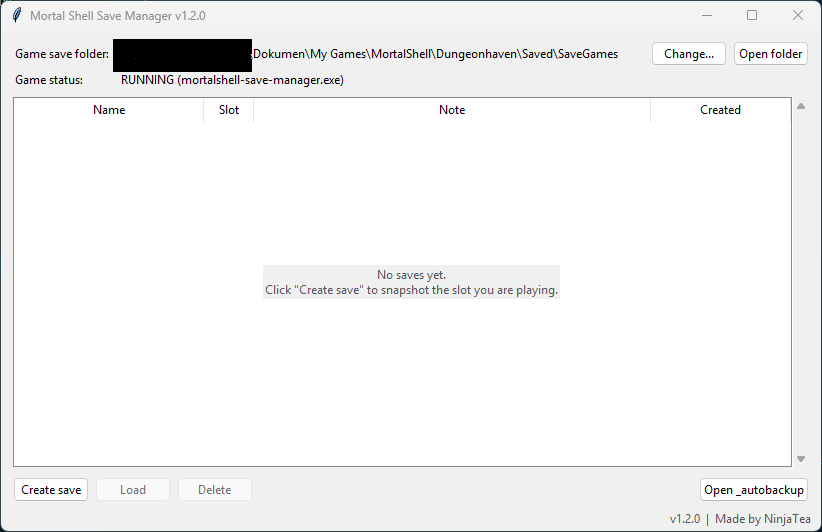

# Mortal Shell Save Manager

Save manager for Mortal Shell on PC. Keep snapshots of your save slots and go back to any of them, for example to the point before a boss.

Made by NinjaTea. Version 1.2.0.



## Download

Get `MortalShellSaveManager.exe` from the [latest release](https://github.com/FaisalTmz007/mortalshell-save-manager/releases/latest) and put it in its own folder. It creates a `saves` folder next to itself, so do not put it in `Program Files`. The tool is also on [Nexus Mods](NEXUS_PAGE_URL).

The source code in this repository is published so you can check what the program does before you run it. You do not need it to use the tool. To run from source, install Python 3.9 or newer, then run `pip install .` followed by `mortalshell-save-manager` (or `python -m mortalshell_save_manager`).

Windows may show a SmartScreen message the first time you run the `.exe`, because it is not code-signed. Click More info, then Run anyway.

## FAQ

### Do I have to close the game before loading a save?

Yes. The game keeps your progress in memory and can write over the files you just loaded. If the program detects the game running, it shows a warning with Continue and Cancel buttons.

### Can I create a save while the game is running?

Yes, because the program only reads and copies files. The game may be writing its files at that moment, though, so create the save right after a checkpoint and not during a loading screen. The same warning appears here too.

### If I delete a save in the program, does my game save disappear?

No. Delete only removes the copy in the program's `saves` folder. Your game files are not touched, so if you loaded that save earlier, the game keeps using it.

### What happens to my current progress when I load a snapshot?

The target slot is copied to `saves\_autobackup` before it is overwritten, and the last 10 backups are kept. To undo a load, copy the files from that backup folder back into your `SaveGames` folder.

### What does "Delete the game's own backup files (_bk_1)" do?

The game keeps its own backups next to each slot, named like `Checkpoints_1_bk_1.sav`. The option is on by default and removes them from the target slot when you load, on the assumption that the game could restore older progress from them. That assumption is untested. If something looks wrong after a load, turn the option off.

### My save went back to the old state after loading. Why?

Most likely the game was running and wrote over it. If you use Steam Cloud, cloud sync may also overwrite the loaded files. This is untested, so if it keeps happening, try turning off cloud sync for the game.

### The program says it cannot find the save folder.

Click Change next to the folder path and pick your `SaveGames` folder. The default location is `Documents\My Games\MortalShell\Dungeonhaven\Saved\SaveGames`.

### The game is running but I got no warning.

The program looks for a process whose name contains `mortalshell`, and the Game status line at the top of the window shows what it found. If the line says not detected while the game is open, your version uses a different process name. Open an issue and include the name shown in Task Manager.

## User's Guide

Things to know:

1. A snapshot is one save slot: `Checkpoints`, `GPData` and `MapState`.
2. Two snapshots cannot have the same name, and capital letters do not count as a difference.
3. A name cannot contain `< > : " / \ | ? *`, cannot start with an underscore, and can be at most 60 characters.
4. A snapshot can be loaded into any slot, not only the one it came from.

Steps:

1. Back up your whole `SaveGames` folder somewhere else before first use.
2. Run the program. It looks for the save folder in the default location and asks you to pick it if it is not there.
3. Click Create save, enter a name, choose the slot you are playing and click Save. A note and the option to include `AchievementSave` and `PlayerSettingsSave` are available in the same dialog.
4. To go back to a snapshot, quit the game, select the snapshot, click Load and choose the slot to overwrite.
5. Start the game and continue.

Keyboard: Ctrl+N creates a save, Enter or a double click loads the selected one, Delete removes it, Escape closes any dialog.

Where things are stored:

| What | Where |
|---|---|
| Game saves | `Documents\My Games\MortalShell\Dungeonhaven\Saved\SaveGames` |
| Your snapshots | `saves` folder next to the `.exe` |
| Backups made before each load | `saves\_autobackup` |
| Program settings | `config.json` next to the `.exe` |

When you run from source, the `saves` folder and `config.json` live in `MortalShellSaveManager` inside your user folder instead. Set the `MORTALSHELL_SAVE_MANAGER_HOME` environment variable to use another location.

## Features

1. Snapshots of a full save slot, with a name and a note
2. Load into any slot
3. Automatic backup of the target slot before every load
4. Game status line, and a Continue or Cancel warning when the game is running
5. Optional inclusion of the achievement and player settings files
6. Keyboard shortcuts for create, load and delete

## Known issues

Tested on PC with the save folder under `Dungeonhaven`. Other store versions are untested. Game detection depends on the process name, as described in the FAQ.

## Repository contents

| Path | Purpose |
|---|---|
| `src/mortalshell_save_manager/` | The program: `store.py` (snapshots), `gui.py` (window), `process.py` (game detection), `paths.py`, `config.py` |
| `tests/` | Automated tests |
| `docs/` | Release notes, Nexus Mods page text and screenshots |
| `.github/` | Continuous integration, release build and issue templates |
| `pyproject.toml` | Package metadata and tool settings |
| `CHANGELOG.md` | Version history |
| `CONTRIBUTING.md` | How to set up, test and release |
| `LICENSE` | MIT license |

## Running the tests

```
pip install -e ".[dev]"
pytest
```

The tests use temporary folders and never touch your real saves. The window tests are skipped when no display is available.

## Disclaimer

Not affiliated with Cold Symmetry or Playstack. Use at your own risk and keep a manual backup of saves you care about. Mortal Shell is a trademark of its respective owners.
